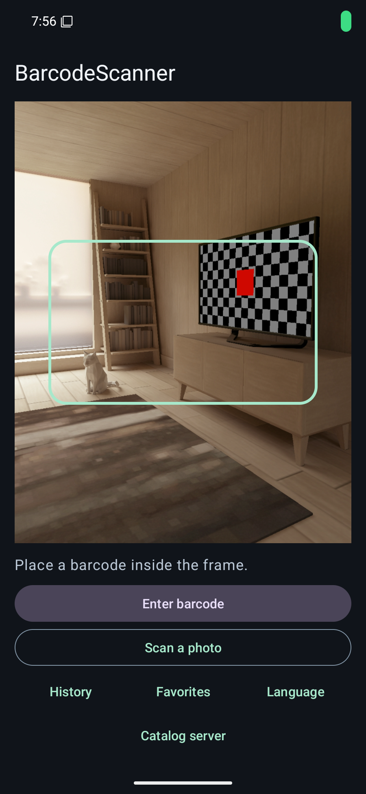
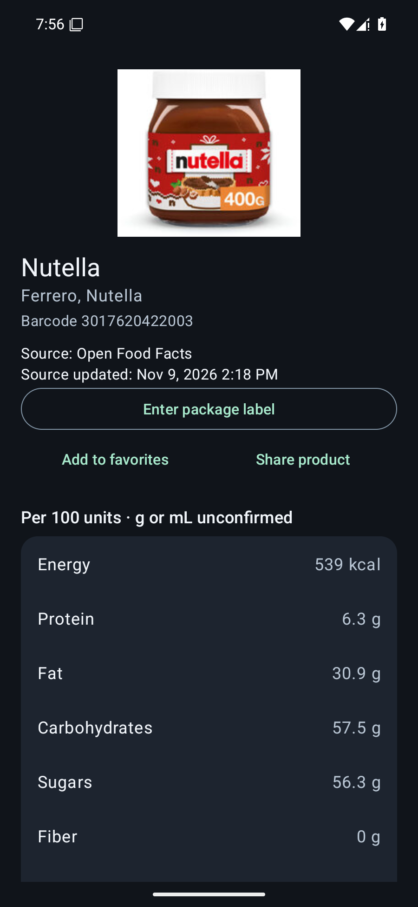
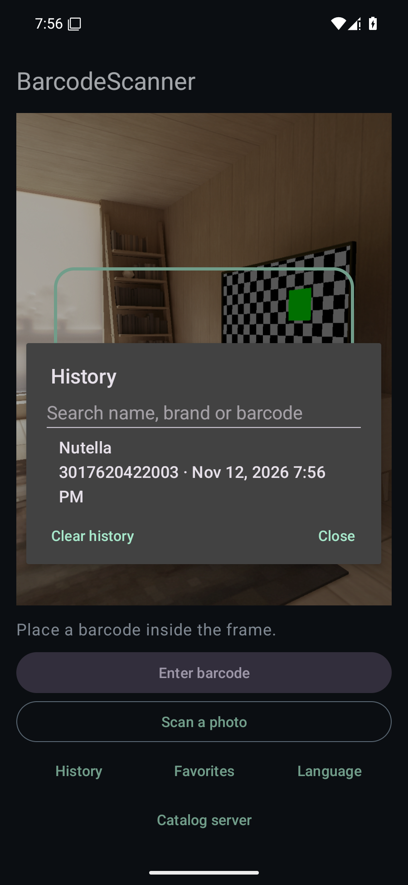

# BarcodeScanner

[**Türkçe**](docs/README.tr.md) · [**Download for Android**](https://github.com/KaanKaya17/BarcodeScanner-OSS/releases/latest) · [**Catalog API**](#catalog-api)

BarcodeScanner looks up packaged foods on Android. Scan with the camera, select a photo from your gallery, or enter the barcode manually to view nutrition facts and calculate values for a portion. Lookups use [Open Food Facts](https://world.openfoodfacts.org/) by default.

## Screenshots

<p>
  
  
  
</p>

The screenshots use a public sample product. Its photo is credited to Open Food Facts contributors under CC BY-SA. [Source product](https://world.openfoodfacts.org/product/3017620422003)

## Features

- Camera scanning for EAN-13, EAN-8, UPC-A and UPC-E, with a flashlight on supported devices. Manual entry accepts 8, 12, 13 and 14 digits.
- Energy, protein, fat, carbohydrates, sugars, fiber and salt. Values start at 100 g or 100 mL and update when you enter a portion size. Missing values appear as “No data”.
- Product name, brand and photo where available, with a link to the source record.
- History keeps the 30 most recent distinct barcodes on the device, including lookups without a result. Open saved product details offline or tap a barcode-only entry to retry.
- English and Turkish. Choose **Language** in the app to switch languages or follow the system setting.
- Product source, update date and nutrition-label photo where available. A configured catalog API also enables source comparison. Enter package values to keep a personal label on your device.
- Scan a photo, search history and favorites by name, brand or barcode, and share the barcode and available source link through Android.
- Set a catalog API address and market in **Catalog server**. See the [integration guide](docs/integration.md).

## Install

Requires Android 8.0 (API 26) or newer. Download the signed APK from GitHub Releases. Open the app and scan a barcode to start. A previous local build signed with a different key requires a fresh install. [Download](https://github.com/KaanKaya17/BarcodeScanner-OSS/releases/latest)

## Catalog API

The Node.js catalog can serve Android, web, or backend clients. Try a public Open Food Facts lookup or run the catalog locally with Node.js 22 or newer.

```sh
npm --prefix api start
```

To use your own catalog in the Android app, open **Catalog server** and enter its HTTPS address and market code. Clear the address to return to direct Open Food Facts lookups.

[Try a lookup](https://barcodescanner-catalog.onrender.com/v1/products/3017620422003?region=TR&compare=true) · [OpenAPI contract](api/openapi.json) · [Integration and hosting](docs/integration.md#english-quick-start)

## Develop

Use Android Studio with JDK 21, Android SDK Platform 36 and Build Tools 36.0.0. For terminal builds set `JAVA_HOME` to JDK 21. On Windows use `gradlew.bat` in place of `./gradlew`.

```sh
./gradlew :app:assembleDebug :app:testDebugUnitTest :app:lintDebug
./gradlew :app:connectedDebugAndroidTest
```

The second command requires an emulator or device. GitHub Actions also builds the release APK and AAB and checks the alignment of their 64-bit native libraries. See [release instructions](docs/releasing.md) and the [changelog](CHANGELOG.md).

## Data and privacy

Camera frames and personal labels stay on the device. Product lookups send the barcode to Open Food Facts or to the configured catalog API. The app stores recent product records when the source permits offline storage. See the [privacy notice](docs/privacy.md).

Open Food Facts provides the product database under ODbL, individual database contents under DbCL, and product photos under CC BY-SA. Each product screen links to its source entry. [Open Food Facts licensing](https://openfoodfacts.github.io/documentation/docs/Product-Opener/api/tutorials/license-be-on-the-legal-side/)

BarcodeScanner's code is released under the MIT license. [License](LICENSE)
