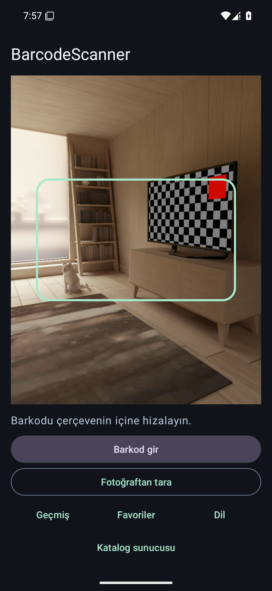
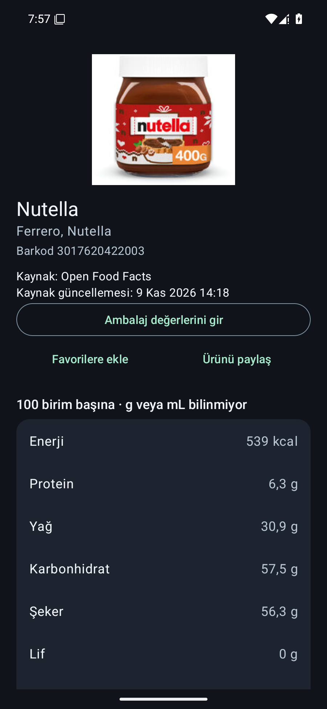
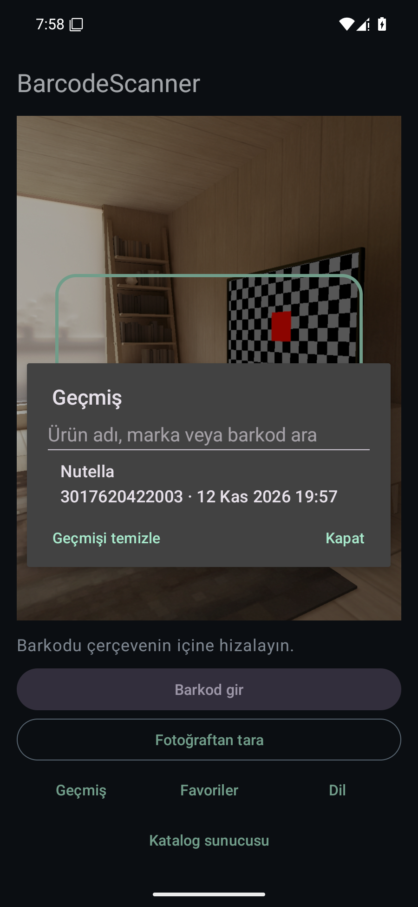

# BarcodeScanner

[**English**](../README.md) · [**Android için indir**](https://github.com/KaanKaya17/BarcodeScanner-OSS/releases/latest) · [**Katalog API’si**](#katalog-apisi)

BarcodeScanner ile Android’de ambalajlı gıdaların besin değerlerine bakabilir ve porsiyon miktarına göre hesaplama yapabilirsin. Barkodu kamerayla tara, galeriden bir fotoğraf seç veya rakamları elle gir. Uygulama varsayılan olarak [Open Food Facts](https://world.openfoodfacts.org/) kullanır.

## Ekran görüntüleri

<p>
  
  
  
</p>

Ekran görüntülerinde herkese açık bir örnek ürün kullanıldı. Ürün fotoğrafı Open Food Facts katkıcılarına aittir ve CC BY-SA kapsamında kullanılmıştır. [Kaynak ürün](https://world.openfoodfacts.org/product/3017620422003)

## Özellikler

- EAN-13, EAN-8, UPC-A ve UPC-E tarama. Desteklenen cihazlarda fener, ayrıca 8, 12, 13 veya 14 rakamlı barkodları elle girme.
- Enerji, protein, yağ, karbonhidrat, şeker, lif ve tuz bilgisi. Ekran 100 g veya 100 mL ile açılır. Porsiyonu değiştirdiğinde değerler yeniden hesaplanır. Eksik alanlarda “Veri yok” gösterilir.
- Veri varsa ürün adı, marka ve fotoğraf. Ürün ekranından kaynak kaydına ulaşabilirsin.
- Geçmiş, sonuç alınamayanlar dahil son 30 farklı barkodu cihazda saklar. Kayıtlı ürün bilgilerini çevrimdışı açabilir, yalnızca barkodu olan bir satıra dokunarak yeniden sorgulayabilirsin.
- Türkçe ve İngilizce. **Dil** menüsünden bir dil seçebilir veya sistem dilini takip edebilirsin.
- Kaynak, güncelleme tarihi ve varsa besin etiketi fotoğrafı. Katalog API'si bağlıysa kaynakları karşılaştırabilir, ambalaj değerlerini kendi cihazında saklayabilirsin.
- Galeriden fotoğraf seçerek barkod okuyabilir, geçmişi ve favorileri ürün adı, marka veya barkodla arayabilirsin. Barkodu ve varsa kaynak bağlantısını Android paylaşım menüsünden gönderebilirsin.
- **Katalog sunucusu** menüsünden API adresini ve pazar kodunu değiştirebilirsin. [Entegrasyon kılavuzu](integration.md)

## Kurulum

Android 8.0 (API 26) veya üzeri gerekir. GitHub Releases üzerinden imzalı APK’yı indirip taramaya başlayabilirsin. Cihazdaki önceki yerel derleme farklı bir anahtarla imzalandıysa temiz kurulum gerekir. [APK’yı indir](https://github.com/KaanKaya17/BarcodeScanner-OSS/releases/latest)

## Katalog API'si

Node.js ile çalışan katalog Android, web ve sunucu uygulamalarından çağrılabilir. Herkese açık örnek sorguyu deneyebilir veya Node.js 22 ve üzeriyle kataloğu yerelde çalıştırabilirsin.

```sh
npm --prefix api start
```

Android uygulamasında kendi kataloğunu kullanmak için **Katalog sunucusu** menüsüne HTTPS adresini ve pazar kodunu gir. Open Food Facts’e doğrudan bağlanmak için adresi temizle.

[Örnek sorgu](https://barcodescanner-catalog.onrender.com/v1/products/3017620422003?region=TR&compare=true) · [OpenAPI sözleşmesi](../api/openapi.json) · [Entegrasyon ve dağıtım](integration.md)

## Geliştirme

Android Studio’da JDK 21, Android SDK Platform 36 ve Build Tools 36.0.0 kullan. Terminalde `JAVA_HOME` değerini JDK 21’e ayarla. Windows’ta `./gradlew` yerine `gradlew.bat` kullan.

```sh
./gradlew :app:assembleDebug :app:testDebugUnitTest :app:lintDebug
./gradlew :app:connectedDebugAndroidTest
```

İkinci komut için emülatör veya Android cihaz gerekir. GitHub Actions, release APK ve AAB paketlerini de derleyip 64 bit yerel kütüphanelerin hizalamasını kontrol eder. [Sürüm hazırlama](releasing.md) · [Değişiklik günlüğü](../CHANGELOG.md)

## Veri ve gizlilik

Kamera görüntüleri ve ambalajdan girdiğin değerler cihazda kalır. Ürün sorgusunda barkod Open Food Facts’e veya yapılandırılan katalog API’sine gönderilir. Çevrimdışı saklamaya uygun ürün kayıtları cihazda saklanır. [Gizlilik bildirimi](privacy.md#türkçe)

Open Food Facts ürün veritabanını ODbL, tekil veritabanı içeriğini DbCL ve ürün fotoğraflarını CC BY-SA kapsamında sunar. Her ürün ekranından kaynak kaydına ulaşılabilir. [Open Food Facts lisansları](https://openfoodfacts.github.io/documentation/docs/Product-Opener/api/tutorials/license-be-on-the-legal-side/)

BarcodeScanner’ın kaynak kodu MIT lisansıyla yayımlanır. [Lisans](../LICENSE)
